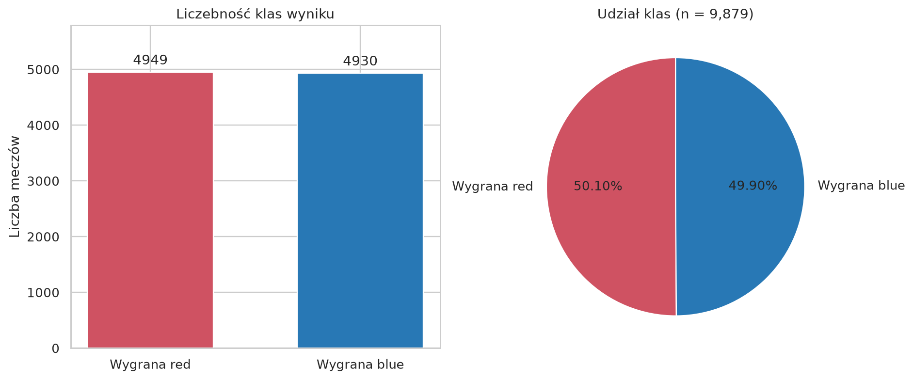
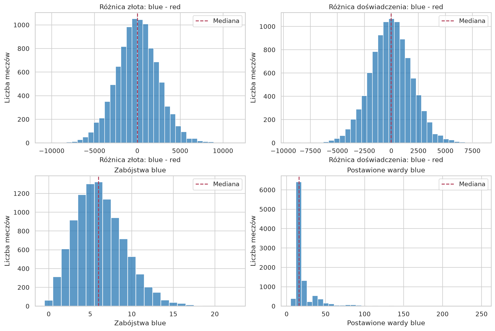
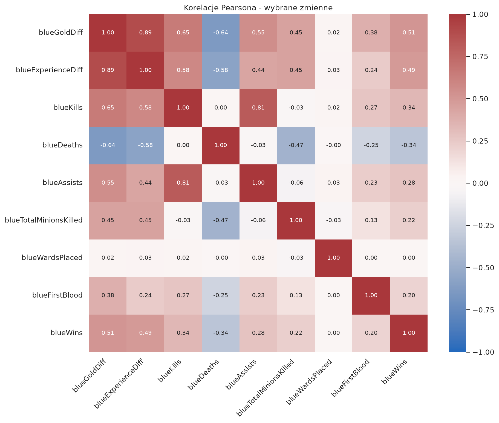
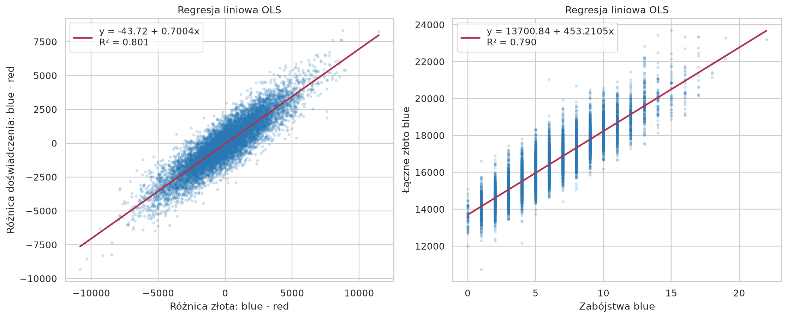
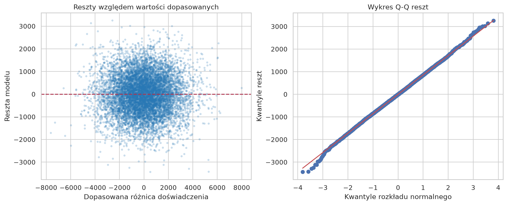
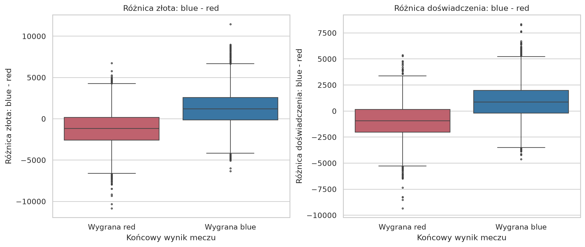
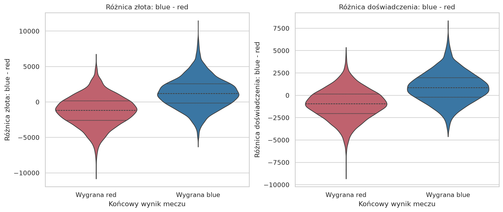

# Analiza statystyczna meczów League of Legends

## Cel i zakres

Realizacja części I („Dane numeryczne”) wymagań projektu. Pytania: jak wyglądają
rozkłady statystyk po 10 minutach, jak różnica złota wiąże się z różnicą doświadczenia
i jak te przewagi wiążą się z końcowym wynikiem meczu?

Źródło: [Yi Lan Ma / bobbyscience, Kaggle](https://www.kaggle.com/datasets/bobbyscience/league-of-legends-diamond-ranked-games-10-min).
Analizowany plik ma **9,879 rekordów i 40 kolumn**.
Jednostką obserwacji jest jeden mecz; `blue` i `red` oznaczają drużyny.
Cechy są agregatami z pierwszych 10 minut, a `blueWins` to końcowy wynik (0 = red, 1 = blue).
`gameId` jest identyfikatorem i nie bierze udziału w statystykach ani korelacjach.

## I.1. Weryfikacja i czyszczenie

- Brakujące komórki przed czyszczeniem: **0**.
- Wartości poza zakodowaną dziedziną, w tym braki: **0**.
- Usunięte dokładne duplikaty: **0**.
- Usunięte rekordy z błędnym ID/wynikiem: **0**.
- Usunięte rekordy z konfliktowymi ID: **0**.
- Zmienione komórki w zachowanych rekordach: **0**.
- Braki po czyszczeniu: **0**.

Funkcja `clean_data` wykrywa tekst w polach liczbowych, NaN, nieskończoność,
ujemne liczniki, ułamkowe liczniki, niepoprawne wartości binarne i poziomy poza [1, 18].
Ujemne różnice złota/XP są poprawne. Braki cech uzupełnia medianą, zaokrągloną
dla liczników, albo dominantą dla kategorii binarnych. Nie imputuje ID ani wyniku.
Kolumny pochodne przelicza z danych podstawowych; poprawne aliasy zabójstw/śmierci
wykorzystuje przed imputacją. Przy sprzeczności pierwszeństwo mają `Kills`, `TotalGold`,
`TotalExperience`, `TotalMinionsKilled`, `Dragons`, `Heralds` i `blueFirstBlood`.
Brak jakiejkolwiek poprawnej wartości cechy powoduje jawny błąd.

Obserwacje poza 1,5 IQR są oznaczane w `tables/outliers.csv`, lecz pozostają w danych.
Szczególnie wardy wymagają ostrożności: maksimum blue wynosi **250**,
red **276**, a mediana blue **16**.
Duża wartość nie stanowi sama w sobie dowodu błędu. Dla IQR = 0 reguła jest pomijana.
Test na osobnej, sztucznie uszkodzonej kopii danych sprawdza rzeczywistą naprawę;
nie dodajemy sztucznych błędów do wyników analizy.

## I.2. Statystyki opisowe

Odchylenie standardowe liczymy dla próbki (`ddof=1`), a kwantyle z interpolacją liniową.
Pełna tabela obejmuje 39 kolumn poza ID: `tables/descriptive_statistics.csv`.
Średnia zmiennej binarnej jest udziałem kategorii 1; kwartyle nie opisują dla niej
rozkładu ciągłego. Smoki i Heroldy są licznikami, choć w tym pliku przyjmują tylko 0/1.

| zmienna | n | min | max | srednia | odchylenie_std | mediana | Q1 | Q3 | P10 | P90 |
| --- | --- | --- | --- | --- | --- | --- | --- | --- | --- | --- |
| blueTotalGold | 9879.00 | 10730.00 | 23701.00 | 16503.46 | 1535.45 | 16398.00 | 15415.50 | 17459.00 | 14645.80 | 18496.20 |
| blueKills | 9879.00 | 0.00 | 22.00 | 6.18 | 3.01 | 6.00 | 4.00 | 8.00 | 3.00 | 10.00 |
| blueGoldDiff | 9879.00 | -10830.00 | 11467.00 | 14.41 | 2453.35 | 14.00 | -1585.50 | 1596.00 | -3078.20 | 3072.00 |
| blueExperienceDiff | 9879.00 | -9333.00 | 8348.00 | -33.62 | 1920.37 | -28.00 | -1290.50 | 1212.00 | -2456.20 | 2386.20 |
| blueWardsPlaced | 9879.00 | 5.00 | 250.00 | 22.29 | 18.02 | 16.00 | 14.00 | 20.00 | 13.00 | 40.00 |

Blue wygrało **4,930** meczów (**49.90%**),
red **4,949** (**50.10%**). Klasy są niemal zrównoważone.

## I.3. Korelacja Pearsona

| x | y | n | r | p_value |
| --- | --- | --- | --- | --- |
| blueGoldDiff | blueExperienceDiff | 9879 | 0.8947 | 0.0000 |
| blueKills | blueTotalGold | 9879 | 0.8888 | 0.0000 |
| blueTotalMinionsKilled | blueTotalGold | 9879 | 0.2849 | 7.72e-184 |
| blueGoldDiff | blueWins | 9879 | 0.5111 | 0.0000 |
| blueExperienceDiff | blueWins | 9879 | 0.4896 | 0.0000 |
| blueKills | blueWins | 9879 | 0.3374 | 1.73e-261 |
| blueDeaths | blueWins | 9879 | -0.3393 | 1.14e-264 |
| blueFirstBlood | blueWins | 9879 | 0.2018 | 2.86e-91 |

Korelacja różnicy złota z różnicą doświadczenia wynosi **r = 0.8947**:
większa przewaga złota wiąże się z większą przewagą XP. Korelacje z `blueWins`
opisują związek z kategorią wyniku; dla pary zmiennej liczbowej i 0/1 Pearson
jest korelacją punktowo-dwuseryjną. Nie oznacza to związku przyczynowego.
Wartości p są dwustronne, eksploracyjne, bez korekty za wielokrotne porównania.
Zapis p = 0 w CSV oznacza niedomiar numeryczny, a nie dosłowne zerowe prawdopodobieństwo.

## I.4. Prosta regresja liniowa

Główny model OLS (x = `blueGoldDiff`, y = `blueExperienceDiff`):

**ŷ = -43.7153 + 0.700354 · x**, **R² = 0.8005**.

Dodatkowe 1000 jednostek przewagi złota wiąże się przeciętnie z
**700.4** jednostkami większej przewagi doświadczenia w dopasowanym modelu.
Model wyjaśnia **80.05%** zmienności różnicy XP w analizowanej próbie.
RMSE na danych dopasowania wynosi **857.61 XP**.

Drugi model (x = `blueKills`, y = `blueTotalGold`):
**ŷ = 13700.8355 + 453.210510 · x**, **R² = 0.7899**.

To analiza zależności w próbie, bez oceny jakości predykcji na nowych meczach.
Nie regresujemy wyniku 0/1 zwykłą prostą jako modelu prawdopodobieństwa.
Nie wybieramy par będących tożsamościami algebraicznymi, np. TotalGold i GoldPerMin.

Na wykresie reszt nie widać wyraźnej krzywizny ani mocnego efektu lejka w centralnej
części danych. Wykres Q-Q jest bliski prostej w środku, z odchyleniami na krańcach,
zwłaszcza w lewym ogonie. To ocena wizualna, nie formalne potwierdzenie założeń.
Nie wyprowadzamy z modelu wniosków przyczynowych.

## I.5. Wizualizacje i ograniczenia

Wykresy porównują przewagi drużyny blue w meczach później wygranych i przegranych.
Wioliny są wygładzonym oszacowaniem gęstości, a nie histogramem.

**Szereg czasowy: nie dotyczy tego zbioru.** Dla każdego meczu istnieje jeden
punkt pomiaru (10. minuta), bez kolejnych minut i daty rozpoczęcia. Indeks wiersza
ani sortowanie po `gameId` nie tworzą szeregu czasowego. Jeśli prowadząca wymaga
tego wykresu bez wyjątku, potrzebny będzie dodatkowy zbiór z pomiarami wielu chwil.

Wyniki dotyczą tej próby meczów o wysokiej randze. Nie są dowodem reprezentatywności
dla wszystkich graczy ani aktualnej wersji gry. Sposób doboru próby i możliwa obecność
tych samych graczy w różnych meczach ograniczają interpretację testów istotności.

## Pokrycie wymagań

| Wymaganie | Realizacja |
| --- | --- |
| I.1. Czyszczenie i braki | `clean_data`, audyt JSON, testy naprawy |
| I.2. Min/max, średnia, SD, mediana, Q1/Q3, P10/P90 | CSV wszystkich cech poza ID |
| I.3. Pearson | Tabela wybranych par i mapa korelacji |
| I.4. Regresja i wzór | Dwa modele OLS, współczynniki, R², rozrzut |
| I.5. Kołowy i słupkowy | Liczebności klas wyniku |
| I.5. Histogram, pudełkowy, wiolinowy | Rozkłady i podział według wyniku |
| I.5. Szereg czasowy | Brak odpowiednich danych; ograniczenie opisane powyżej |
